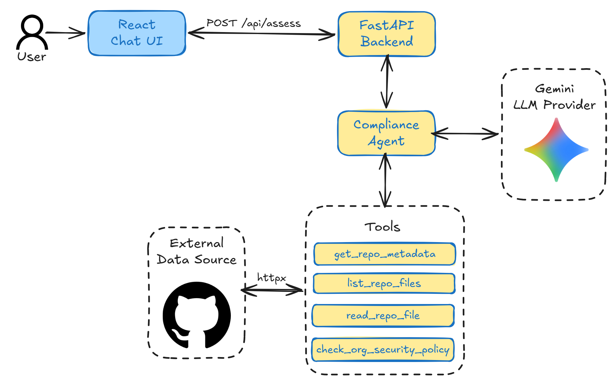

# GitHub Compliance Agent

A compliance audit tool built with **FastAPI**, **Google Gemini (`google-genai`)**, and **React + TypeScript (Vite)**. It connects to any public GitHub repository via the GitHub REST API, retrieves evidence using tool calls, evaluates 5 governance controls, answers natural-language compliance questions, and exports structured compliance reports.

## Evaluated Governance Controls

| Control                 | Requirement                                                           |
| ----------------------- | --------------------------------------------------------------------- |
| **Documentation**       | Does the repository contain a nonempty `README` file?                 |
| **Licensing**           | Does the repository use an approved license (`MIT` or `Apache-2.0`)?  |
| **Model Documentation** | Does the repository contain a model card?                             |
| **AI Transparency**     | Are the model's intended use and limitations adequately documented?   |
| **Security**            | Does the repository (or `<owner>/.github`) contain a security policy? |

Each control returns `PASS`, `FAIL`, or `UNKNOWN`, along with supporting evidence, clickable GitHub source references, decision explanation, and recommended remediation actions.

## Architecture & Technical Decisions



- **Direct `google-genai` SDK over heavy frameworks**: Uses a two-phase loop (tool-calling evidence retrieval followed by `response_schema=ReportDraft` JSON synthesis) so control evaluations are schema-validated and straightforward to test.
- **Minimal GitHub API footprint**: Uses the recursive Git Trees endpoint (`?recursive=1`, prioritized by governance filenames and capped) with fallback to `/contents` directory listing, plus an org-level `<owner>/.github` check for `SECURITY.md`.
- **Fail-safe `UNKNOWN` semantics**: HTTP 404s, rate limits (`403`/`429`), timeouts, binary files, or LLM errors are caught cleanly and reported as `UNKNOWN` rather than guessed.
- **Extensible policy registry**: All governance controls live in [`backend/policies.py`](backend/policies.py) as `ControlDefinition` entries, making it easy to add or modify controls without touching agent orchestration.
- **Decoupled UI & CLI**: The FastAPI server powers the React + TypeScript chat interface (`frontend/`) while `backend/report.py` provides headless Markdown report generation.

## Installation & Setup

### Prerequisites

- Python **3.12+** (with [`uv`](https://docs.astral.sh/uv/) or `pip`)
- Node.js **18+** and `npm`
- A Gemini API key (`GEMINI_API_KEY`)

### 1. Configure Environment Variables

Copy `.env.example` to `.env` and add your Gemini API key (and an optional GitHub personal access token to raise the unauthenticated 60 req/hr rate limit to 5,000 req/hr):

```powershell
Copy-Item .env.example .env
```

```env
GEMINI_API_KEY=your_gemini_api_key_here
GEMINI_MODEL=gemini-3.8-flash
GITHUB_TOKEN=
```

### 2. Install Backend Dependencies

```powershell
uv venv .venv --python 3.12
uv pip install --python .venv\Scripts\python.exe -e ".[dev]"
```

### 3. Install Frontend Dependencies

```powershell
cd frontend
npm install
cd ..
```

## Running the Application

Start both servers in separate terminals:

**Terminal 1: FastAPI Backend (`http://127.0.0.1:8000`)**

```powershell
.venv\Scripts\uvicorn backend.main:app --reload --host 127.0.0.1 --port 8000
```

**Terminal 2: React + TypeScript Chat UI (`http://localhost:5173`)**

```powershell
cd frontend
npm run dev
```

Open `http://localhost:5173` in your browser, enter any GitHub repository URL (defaults to `https://github.com/openai/whisper`), and ask compliance questions or select a quick prompt. Reports can be downloaded directly as `.md` or `.json`.

## CLI Report Generation

Run a compliance audit headlessly and save the Markdown report:

```powershell
.venv\Scripts\python -m backend.report https://github.com/openai/whisper --output reports/openai_whisper_report.md
```

- Sample generated report for `openai/whisper`: [`reports/openai_whisper_report.md`](reports/openai_whisper_report.md)

## Running Tests

Run the offline automated test suite (uses `httpx.MockTransport`, FastAPI `TestClient`, and mocked Gemini responses):

```powershell
.venv\Scripts\pytest -v
```

Verify the frontend TypeScript check and production build:

```powershell
cd frontend
npm run build
```

## UI Screenshots

To capture screenshots for submission, open `http://localhost:5173` with both servers running, run an assessment on `https://github.com/openai/whisper`, and save screenshots under `docs/screenshots/`.
